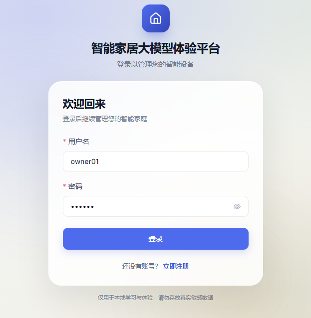
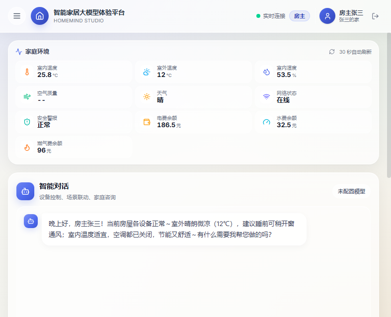

# HomeMind · 智能家居大模型体验平台

> 把大模型 Agent 接入真实家居场景：一句话完成设备控制、场景联动、知识问答与全屋报告。

体验地址：**<http://39.106.179.22/login>**

首次使用请注册一个新家庭；注册后当前账号即为房主，可继续创建住户和访客账号。

<p align="center">
  
  
</p>

<p align="center">
  <sub>左：注册 / 登录入口　右：AI 智能助理（多意图对话、设备控制、家庭报告）</sub>
</p>

---

## 项目简介

HomeMind 是一个面向智能家居场景的全栈大模型应用。用户通过自然语言与 AI 助理交互，系统会自动理解意图、拆分任务，并按需并发执行：

- 情感闲聊
- 家庭知识库问答
- 设备状态查询与控制
- 场景联动
- 全屋状态报告

后端使用 **FastAPI + LangGraph** 编排状态图，前端使用 **Vue 3 + Vite** 构建玻璃拟态 SPA，内置设备模拟器，无需真实硬件即可跑通完整流程。

---

## 核心能力

### 1. 多意图 Agent

一次输入可以拆成多个子任务并发执行，例如：

> “我感冒了，把卧室空调调到 26 度，顺便看看药箱里有什么药。”

会拆成：

- `chat`：健康关怀
- `control`：调节卧室空调
- `knowledge`：检索家庭药箱资料

主图包含输入护栏、上下文装配、结构化规划、多分支并发、结果汇总、回复生成、输出校验和会话落库。

### 2. 设备控制与人工审批

设备控制使用独立子图：

```text
context → plan → validate → approval → dispatch → execute → observe → verify
                                      ↘ cancel
```

- 低风险操作自动执行
- 中高风险操作通过 LangGraph `interrupt()` 挂起，用户确认后 `Command(resume)` 恢复
- 访客只读；住户中高风险需审批；房主高风险也需审批
- 用户取消时只影响控制分支，其他分支结果仍会汇总

### 3. 回复证据门槛

模型不能凭空声称“已为您打开空调”：

- 按设备、房间、属性逐句核对本轮真实工具执行记录
- 部分成功时只保留有依据的分句
- 失败项会明确告知用户
- 没有执行记录时禁止输出设备动作声明

### 4. 工具与家庭隔离

当前工具集：

- 设备状态设置
- 设备状态查询
- 房间设备列表
- 场景触发
- 当前时间
- 家庭天气
- 用户画像
- 全屋快照
- 知识检索

所有工具通过 `InjectedState` 注入服务端身份，模型无法伪造 `user_id / family_id / role`；设备、房间、场景、文件查询均按 `family_id` 隔离。

### 5. RAG 家庭知识库

- 用户私有文档 + 家庭规章制度双集合
- 阿里云 DashScope `text-embedding-v2` 向量化
- ChromaDB 缺失时回退本地 JSON 余弦检索
- 按 `user_id / family_id` 过滤，避免跨家庭检索
- 回复带来源引用

### 6. 个人模型配置

不再依赖 `.env` 固定模型，每个用户可以自行添加：

- 阿里云通义千问
- DeepSeek
- 智谱 GLM
- 本地 Ollama

支持新增、编辑、删除；API Key 在服务端使用 Fernet 加密存储，接口不返回明文。模型下拉框只展示用户自己的配置，未配置时禁止发送消息。

### 7. 上下文与可靠性

- 最近 6 轮原文保留，更早历史做两级压缩
- Postgres checkpointer 持久化中断态，失败时降级 MemorySaver
- 同一会话并发请求快速失败 409
- `thread_id` 编码 `family_id / user_id / session_id`，防止跨家庭会话碰撞
- SSE / WebSocket 流式输出
- 输入护栏、输出护栏、AI 生成标识

---

## 技术栈

| 模块 | 技术 |
|---|---|
| 后端 | Python 3.11+ · FastAPI · SQLAlchemy 2 Async · Pydantic 2 |
| Agent | LangGraph · LangChain · ToolNode · interrupt/resume · Send 并发 |
| 数据库 | MySQL 8.0 / MariaDB（业务库） · PostgreSQL（LangGraph checkpointer） |
| RAG | ChromaDB · DashScope text-embedding-v2 |
| 前端 | Vue 3 · Vite 5 · Pinia · Vue Router · Element Plus · Tailwind CSS |
| 实时 | WebSocket · SSE |
| 语音 | Whisper（可选） · Edge-TTS |
| 调度 | APScheduler（扫地机设备模拟） |

---

## 系统架构

```text
Vue 3 SPA
   │ HTTPS / WSS
   ▼
Nginx
   ├─ /                 → 前端静态资源
   └─ /api/             → FastAPI
                            │
                            ▼
                    LangGraph 主图
       input_guard → load_context → planner
                                      │
                     ┌────────────────┼────────────────┐
                     ▼                ▼                ▼
                   chat           knowledge          control 子图
                     │                │                │
                     └────────────────┼────────────────┘
                                      ▼
                                  aggregate
                                      │
                                  compose
                                      │
                                output_guard
                                      │
                                   persist
                                      │
                                      ▼
                              MySQL / MariaDB
```

---

## 快速开始

### 环境要求

- Python 3.11+
- Node.js 18+
- MySQL 8.0 或 MariaDB
- 可选：PostgreSQL（LangGraph 中断态持久化）
- 至少一个模型 API Key，或本地 Ollama

### 方式一：Docker Compose

```bash
cd backend
cp .env.example .env
# 填写 QWEN_API_KEY / DASHSCOPE_API_KEY / JWT_SECRET
docker compose up -d mysql postgres
docker compose up --build backend
```

### 方式二：本地运行

```bash
# 1. 初始化数据库
mysql -u root -p < database/init.sql

# 2. 后端
cd backend
python3.11 -m venv .venv
source .venv/bin/activate
pip install -r requirements.txt
cp .env.example .env
uvicorn homemind.main:app --reload --host 127.0.0.1 --port 8000

# 3. 前端
cd ../frontend
npm ci
npm run dev
```

打开：

- 前端：<http://127.0.0.1:5173>
- 接口文档：<http://127.0.0.1:8000/docs>

首次使用请在注册页创建家庭，注册账号会成为房主。

---

## 关键配置

`backend/.env` 至少需要：

```dotenv
MYSQL_URL=mysql+aiomysql://root:密码@127.0.0.1:3306/smart_home

JWT_SECRET=用-openssl-rand-hex-32-生成
MODEL_CONFIG_SECRET=可选，留空回退到-JWT_SECRET

LLM_PROVIDER=qwen
QWEN_API_KEY=你的-key
QWEN_MODEL=qwen-plus

DASHSCOPE_API_KEY=你的-key

# 没有 Postgres 时关闭，使用 MemorySaver
LANGGRAPH_PERSISTENCE_ENABLED=false
```

模型也可以不写死在 `.env`：登录后在 AI 助理右上角「对话模型 → 模型管理」中添加个人配置。

---

## 目录结构

```text
HomeMind/
├── backend/
│   ├── homemind/
│   │   ├── agent/          # LangGraph 主图、控制子图、规则、工具
│   │   ├── api/            # FastAPI 路由
│   │   ├── core/           # 配置、数据库、异常
│   │   ├── llm/            # 多模型工厂与 LangChain 适配
│   │   ├── models/         # SQLAlchemy ORM
│   │   ├── rag/            # 分块、向量化、检索
│   │   ├── repositories/   # 数据访问
│   │   ├── schemas/        # Pydantic 模型
│   │   ├── services/       # 业务逻辑
│   │   ├── scheduler/      # 设备模拟
│   │   ├── voice/          # STT / TTS
│   │   └── websocket/      # 实时推送
│   ├── migrations/         # Alembic
│   └── requirements.txt
├── frontend/               # Vue 3 SPA
├── database/init.sql       # 建库、建表、演示数据
├── deploy/                 # Nginx / systemd / MariaDB 部署模板
├── docs/                   # 架构、评测与部署文档
└── evals/                  # Agent 离线评测
```

---

## 测试与评测

```bash
cd backend
pytest

# 规则模式离线评测
python -m evals.runner

# 真实模型端到端评测（需要 API Key）
python -m evals.e2e

# 接口性能基准
python -m evals.api_benchmark
```

测试覆盖：

- 规则解析、风险策略、证据门槛
- Repository / Service / API
- Agent 图结构、并发分支、中断恢复
- RAG 检索、文件可见性
- 端到端设备控制、审批、取消、权限与异常场景

---

## 部署

- 阿里云 1GB + 宝塔部署：[docs/阿里云ALinux3-1GB现场部署步骤.md](docs/阿里云ALinux3-1GB现场部署步骤.md)
- 通用 1GB 部署：[docs/阿里云1GB宝塔部署指南.md](docs/阿里云1GB宝塔部署指南.md)
- Mac 本地环境：[docs/Mac开发环境搭建.md](docs/Mac开发环境搭建.md)

部署模板：

- `deploy/nginx/smart-home.conf`
- `deploy/systemd/smart-home-api.service`
- `deploy/mysql/1gb-low-memory-mariadb.cnf`
- `deploy/scripts/deploy_backend.sh`
- `deploy/scripts/backup_mysql.sh`

---

## 说明

本项目仅用于学习与交流，禁止任何形式的商业用途。

任何使用、修改、二次开发或参考本项目的行为，必须注明出处并引用本项目仓库（GitHub：<https://github.com/Lucky-belongs-RUI/HomeMind>）。
