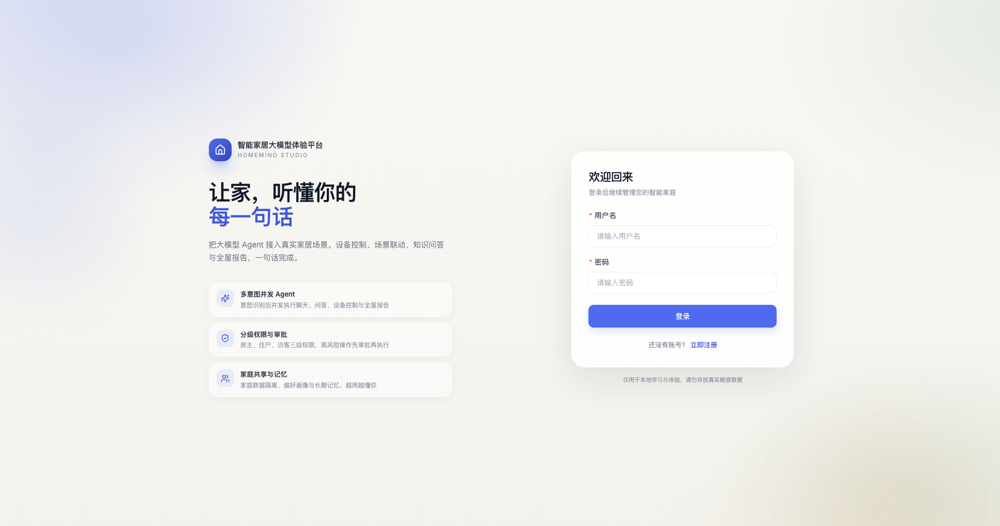
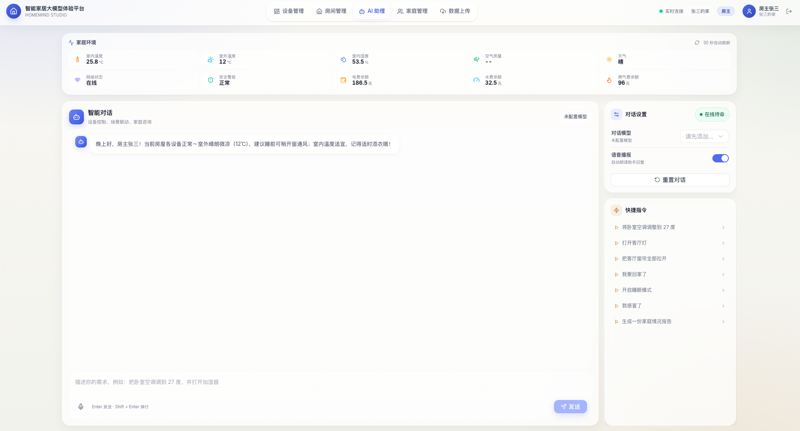

# HomeMind・智能家居大模型体验平台

> 
> 把大模型 Agent 接入真实家居场景：一句话完成设备控制、场景联动、知识问答与全屋报告。

体验地址：**[http://39.106.179.22/login](http://39.106.179.22/login)**

首次使用请注册一个新家庭；注册后当前账号即为房主，可继续创建住户和访客账号。

<p align="center">

</p>
<p align="center">
<sub>图1：注册 / 登录入口</sub>
</p><p align="center">

</p>
<p align="center">
<sub>图2：AI 智能助理对话界面（多意图对话、设备控制、家庭报告）</sub>
</p>
---

## 项目简介

HomeMind 是一个面向智能家居场景的全栈大模型应用。用户通过自然语言与 AI 助理交互，系统会自动理解意图、拆分任务，并按需并发执行。

主要能力覆盖：

- 情感闲聊
- 家庭知识库问答
- 设备状态查询与控制
- 场景联动
- 全屋状态报告

后端基于 **FastAPI + LangGraph** 编排状态图；前端采用 **Vue 3 + Vite** 构建玻璃拟态风格单页应用，内置设备模拟器，无需真实硬件即可跑通完整业务流程。

---

## 核心能力

### 1. 多意图 Agent

单轮用户输入可拆解为多个子任务并发执行。
示例用户指令：

> 
> “我感冒了，把卧室空调调到 26 度，顺便看看药箱里有什么药。”

系统自动拆分为三条独立任务分支：

- `chat`：健康关怀闲聊
- `control`：调节卧室空调
- `knowledge`：检索家庭药箱资料

Agent 主流程包含输入护栏、上下文装配、结构化规划、多分支并发、结果汇总、回复生成、输出校验和会话落库环节。

### 2. 设备控制与人工审批

设备控制逻辑封装为独立子图，流程如下：

```
context → plan → validate → approval → dispatch → execute → observe → verify
                                      ↘ cancel
```

- 低风险操作自动执行；
- 中高风险操作通过 LangGraph `interrupt()` 挂起，用户确认后调用 `Command(resume)` 恢复执行；
- 访客仅拥有只读权限；住户执行中高风险操作需要审批；房主执行高风险操作同样需要审批；
- 用户取消控制分支时，仅终止设备控制流程，其余分支结果正常汇总。

### 3. 回复证据门槛

模型禁止无依据地生成设备动作结果：

- 按设备、房间、属性逐句核对本轮工具真实执行记录；
- 部分任务成功时，仅保留有执行记录支撑的分句；
- 任务失败项会明确告知用户；
- 不存在对应工具执行记录时，禁止输出设备动作类声明。

### 4. 工具与家庭隔离

内置工具集：设备状态设置、设备状态查询、房间设备列表、场景触发、当前时间、家庭天气、用户画像、全屋快照、知识检索。

所有工具通过 `InjectedState` 注入服务端身份信息，模型无法伪造 `user_id / family_id / role`；设备、房间、场景、文档查询均基于 `family_id` 做数据隔离，实现家庭之间数据隔离。

### 5. RAG 家庭知识库

- 支持用户私有文档 + 家庭规章制度双检索集合；
- 向量化模型：阿里云 DashScope `text-embedding-v2`；
- 存储降级策略：ChromaDB 不可用时，回退本地 JSON 余弦相似度检索；
- 检索结果按 `user_id / family_id` 过滤，避免跨家庭泄露；
- 回复附带来源引用。

### 6. 个人模型配置

模型配置不再硬编码在 `.env` 中，支持用户自主配置多后端：

- 阿里云通义千问
- DeepSeek
- 智谱 GLM
- 本地 Ollama

支持新增、编辑、删除模型配置；API Key 在服务端使用 Fernet 加密存储，接口不返回明文密钥。模型下拉框仅展示当前用户自己配置的模型，未配置模型时禁止发送对话消息。

### 7. 上下文与可靠性

- 会话缓存：保留最近 6 轮原始对话，更早历史采用两级压缩策略；
- 状态持久化：Postgres checkpointer 持久化 LangGraph 中断状态，Postgres 不可用时降级为 MemorySaver；
- 并发控制：同一会话并发请求快速失败，返回 409；
- 会话隔离：`thread_id` 编码 `family_id / user_id / session_id`，防止跨家庭会话碰撞；
- 流式输出：支持 SSE / WebSocket 流式返回；
- 安全护栏：输入护栏、输出护栏、AI 生成标识。

---

## 技术栈

表格

| 模块 | 技术选型 |
| --- | --- |
| 后端 | Python 3.11+ · FastAPI · SQLAlchemy 2 Async · Pydantic 2 |
| Agent | LangGraph・LangChain・ToolNode・interrupt/resume・Send 并发 |
| 数据库 | MySQL 8.0 / MariaDB（业务库）・PostgreSQL（LangGraph checkpointer） |
| RAG | ChromaDB · DashScope text-embedding-v2 |
| 前端 | Vue 3 · Vite 5 · Pinia · Vue Router · Element Plus · Tailwind CSS |
| 实时通信 | WebSocket · SSE |
| 语音（可选） | Whisper · Edge-TTS |
| 任务调度 | APScheduler（扫地机设备模拟） |

---


## 快速开始

### 环境依赖

- Python 3.11+
- Node.js 18+
- MySQL 8.0 或 MariaDB
- 可选：PostgreSQL（LangGraph 中断态持久化）
- 至少一个大模型 API Key，或本地 Ollama 服务

### 方式一：Docker Compose

```
cd backend
cp .env.example .env
# 填写 QWEN_API_KEY / DASHSCOPE_API_KEY / JWT_SECRET
docker compose up -d mysql postgres
docker compose up --build backend
```

### 方式二：本地运行

```
# 1. 初始化数据库
mysql -u root -p < database/init.sql

# 2. 启动后端
cd backend
python3.11 -m venv .venv
source .venv/bin/activate
pip install -r requirements.txt
cp .env.example .env
uvicorn homemind.main:app --reload --host 127.0.0.1 --port 8000

# 3. 启动前端
cd ../frontend
npm ci
npm run dev
```

访问地址：

- 前端页面：[http://127.0.0.1:5173](http://127.0.0.1:5173)
- 接口文档：[http://127.0.0.1:8000/docs](http://127.0.0.1:8000/docs)

> 
> 首次使用说明：在注册页面创建家庭，注册账号自动成为房主。

---

## 关键配置

后端配置文件 `backend/.env` 最低必填项：

```
MYSQL_URL=mysql+aiomysql://root:密码@127.0.0.1:3306/smart_home

JWT_SECRET=用-openssl-rand-hex-32-生成
MODEL_CONFIG_SECRET=可选，留空回退到-JWT_SECRET

LLM_PROVIDER=qwen
QWEN_API_KEY=你的-key
QWEN_MODEL=qwen-plus

DASHSCOPE_API_KEY=你的-key

# 无 Postgres 时关闭，降级 MemorySaver
LANGGRAPH_PERSISTENCE_ENABLED=false
```

> 
> 模型配置也可以不写死在 `.env`：登录后在 AI 助理右上角「对话模型 → 模型管理」添加个人配置。

---

## 目录结构

```
HomeMind/
├── backend/
│   ├── homemind/
│   │   ├── agent/          # LangGraph 主图、控制子图、规则、工具
│   │   ├── api/            # FastAPI 路由
│   │   ├── core/           # 配置、数据库、异常
│   │   ├── llm/            # 多模型工厂与 LangChain 适配
│   │   ├── models/         # SQLAlchemy ORM
│   │   ├── rag/            # 分块、向量化、检索
│   │   ├── repositories/   # 数据访问层
│   │   ├── schemas/        # Pydantic 数据模型
│   │   ├── services/       # 业务逻辑层
│   │   ├── scheduler/      # 设备模拟调度
│   │   ├── voice/          # STT / TTS 语音模块
│   │   └── websocket/      # 实时推送
│   ├── migrations/         # Alembic 数据库迁移
│   └── requirements.txt
├── frontend/               # Vue 3 单页应用
├── database/init.sql       # 建库、建表、演示初始化数据
├── deploy/                 # Nginx / systemd / MariaDB 部署模板
├── docs/                   # 架构、评测、部署文档
└── evals/                  # Agent 离线评测脚本
```

---

## 测试与评测

```
cd backend
pytest

# 规则模式离线评测
python -m evals.runner

# 真实模型端到端评测（需要配置模型API Key）
python -m evals.e2e

# 接口性能基准测试
python -m evals.api_benchmark
```

测试覆盖范围：

- 规则解析、风险策略、回复证据门槛
- Repository / Service / API 单元测试
- Agent 图结构、并发分支、中断恢复逻辑
- RAG 检索、文档可见性权限
- 端到端设备控制、审批、取消、权限与异常场景

---


## 声明

本项目仅用于学习与学术交流，禁止任何形式的商业用途。
任何使用、修改、二次开发或参考本项目的行为，必须注明出处并引用项目仓库：
GitHub：[https://github.com/Lucky-belongs-RUI/HomeMind](https://github.com/Lucky-belongs-RUI/HomeMind)
